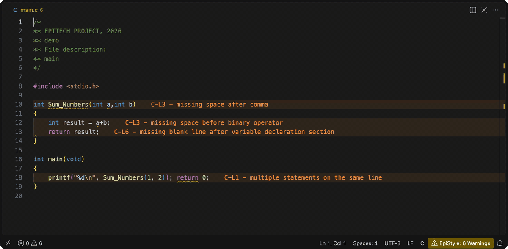

<div align="center">


# EpiStyle

**Real-time Epitech coding style checker for Visual Studio Code**

Get Epitech coding style violations in your editor every time you save.

[](https://marketplace.visualstudio.com/items?itemName=maty-millien.epitech-vs-coding-style)
[](https://marketplace.visualstudio.com/items?itemName=maty-millien.epitech-vs-coding-style)
[](https://marketplace.visualstudio.com/items?itemName=maty-millien.epitech-vs-coding-style)
[](LICENSE)
[](https://www.docker.com/)

</div>

---

## Overview

EpiStyle runs Epitech's coding style checker, [epiclang](https://launchpad.net/~epitech/+archive/ubuntu/ppa) with the Banana plugin, every time you save a C file. Violations show up inline and in the Problems panel with their rule code and description, so you can fix them before the moulinette sees them.

## Preview

<div align="center">



<sub>Each save rechecks the file, until the status bar reads Clean. Shown with <a href="https://marketplace.visualstudio.com/items?itemName=usernamehw.errorlens">Error Lens</a>.</sub>

</div>

## Features

- Saving a `.c` or `.h` file checks that file only, in under a second once the checker is running.
- Opening the first C file of a session, or creating, deleting or renaming C files, checks the whole workspace, including the repository rules (C-O1 unwanted files, C-O4 file names).
- Diagnostics point to the exact line and column reported by epiclang.
- Files matched by `.gitignore` or by the `excludePaths` setting are skipped.
- The status bar shows the warning count. Click it to turn the checker on or off.

> **Tip:** Pair EpiStyle with [Error Lens](https://marketplace.visualstudio.com/items?itemName=usernamehw.errorlens) to see each warning at the end of its line.

## Requirements

EpiStyle needs [Visual Studio Code](https://code.visualstudio.com/) `1.145+` and one of these:

- **epiclang installed locally.** On Ubuntu, add `ppa:epitech/ppa` and install `epiclang banana-coding-style-checker` (already there on the Epitech Ubuntu image). If `clang-21`, `banana-check-repo` and at least one plugin in `/usr/lib/epiclang/plugins` or `/usr/local/lib/epiclang/plugins` are present, EpiStyle uses them directly and loads every plugin it finds there.
- **Docker**, on macOS, Windows or any Linux. Docker Desktop, [OrbStack](https://orbstack.dev/), [Colima](https://github.com/abiosoft/colima), [Rancher Desktop](https://rancherdesktop.io/) or a native `dockerd` all work. Start it before opening VS Code.

Epitech only publishes epiclang as Ubuntu amd64 packages, so with Docker, EpiStyle builds a local image (`epistyle-epiclang`, about 360 MB, holding only clang, the Banana plugin, the system headers and the CSFML and ncurses headers) from Epitech's PPA the first time it runs. This takes a few minutes, and the image is rebuilt in the background once it's more than a week old. On Apple Silicon the image runs under amd64 emulation, which is why a check takes around half a second. EpiStyle keeps one container running per workspace folder and stops it when VS Code closes.

## Installation

1. Install epiclang or Docker as described above.
2. Install EpiStyle from the **Extensions** panel or the [Marketplace](https://marketplace.visualstudio.com/items?itemName=maty-millien.epitech-vs-coding-style).
3. Open a C file in your project. The first check starts on its own.

## Configuration

| Setting                             | Default      | Description                                                            |
| ----------------------------------- | ------------ | ---------------------------------------------------------------------- |
| `epitech-coding-style.enable`       | `true`       | Enable or disable style checks                                         |
| `epitech-coding-style.excludePaths` | `["tests/"]` | Gitignore-style patterns to skip, on top of the project's `.gitignore` |

Plugin options go in a TOML `.epiclang` file at the project root, one table per plugin. EpiStyle passes each string value to clang as `-fplugin-arg-<plugin>-<key>=<value>`:

```toml
[plugins.banana]
key = "value"
```

## Commands

| Command                           | Description                                                                                                   |
| --------------------------------- | ------------------------------------------------------------------------------------------------------------- |
| `EpiStyle: Rebuild Checker Image` | Stops the checker containers and rebuilds the image from the latest PPA packages, then rechecks the workspace |

## Known issues

- Every folder containing a `.h` file is passed to epiclang as an include path. A header that lives elsewhere, or a library missing from the image, stops the check at that `#include`, and EpiStyle reports it as an error on that line.
- Makefiles are no longer checked, since Banana has no Makefile rules.

## Contributing

Open an issue or a pull request on the [GitHub repository](https://github.com/maty-millien/EpiStyle). Run `bun install`, then `bun run ci` to format, lint, typecheck and build.

## Disclaimer

EpiStyle is an independent open-source project and is **not affiliated with, endorsed by, or sponsored by Epitech**. "Epitech" is a trademark of its owner. EpiStyle runs epiclang and Banana as installed on your machine, or in a Docker image built on your machine from Epitech's public PPA. It doesn't bundle or redistribute either tool.

## License

Distributed under the [MIT License](LICENSE), © [Maty MILLIEN](https://github.com/maty-millien)
